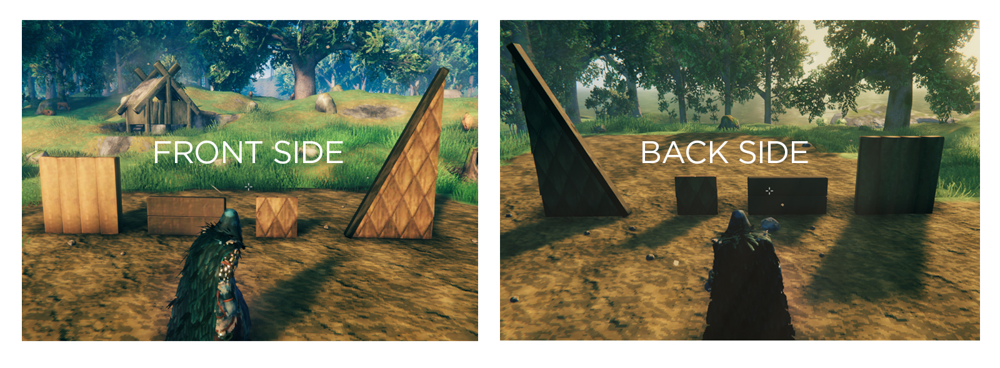

# Symmetrical Building Pieces

Vanilla walls only look good from one side: flip to the inside of your hall and you get crossbars, X-braces and backing boards. **Symmetrical Building Pieces** adds a copy of each wall that shows the clean face on **both** sides.

Each symmetrical wall sits right next to its vanilla version in the Hammer menu, marked **(Symmetrical)**. Cost, health, snapping and collision are identical to vanilla.

## Pieces

| Material | Pieces |
|---|---|
| Wood | Wood Wall 1x1, Wood Wall Half, Wood Wall |
| Ashwood | Ashwood Quarter Wall, Ashwood Half Wall, Ashwood Wall |
| Scalewood | Quarter Wall, Half Wall, Wall, 26°, 45°, 67° (and inverted angles) |
| Timber | Timber Wall |

A symmetrical left-angled wall is the same as a symmetrical right-angled wall turned around, so one set of angled pieces covers both.

## How it works

The mod clones the vanilla pieces at runtime and rebuilds their meshes from the good face, so no vanilla models or textures are shipped with the mod. Worn and broken damage states are symmetrical too.

## Multiplayer

**Everyone needs it, including the server.** Players without the mod won't be able to see the symmetrical pieces.

## Configuration

`BepInEx/config/bhimajenkins.symmetricalbuildingpieces.cfg`

| Setting | What it does |
|---|---|
| `Pieces` | Which vanilla prefabs to make symmetrical. Add `:+`, `:-` or `:flip` after a name to choose which face is kept. |
| `NameSuffix` | Text added after the name in the build menu. Default ` (Symmetrical)`. |
| `MirrorPlane` / `MirrorPlaneOffset` | Advanced: where the mirror plane sits. |

Changing which face is kept updates placed pieces live.

## Console commands (F5)

- `sbp_dump [filter]` writes Hammer pieces matching the filter (default `wall`) to the BepInEx log, with their prefab names. Use it to find names to add to `Pieces`.
- `sbp_rebuild` reloads the config and rebuilds every symmetrical mesh.

## Custom icons

Put a PNG named after the prefab (for example `ashwood_wall_2x2.png`) in the mod's `icons` folder to replace that piece's icon.

## Compatibility

- Built for Valheim 1.0 (Deep North).
- No Jötunn dependency.
- Doesn't change any vanilla pieces; it only adds new ones.
